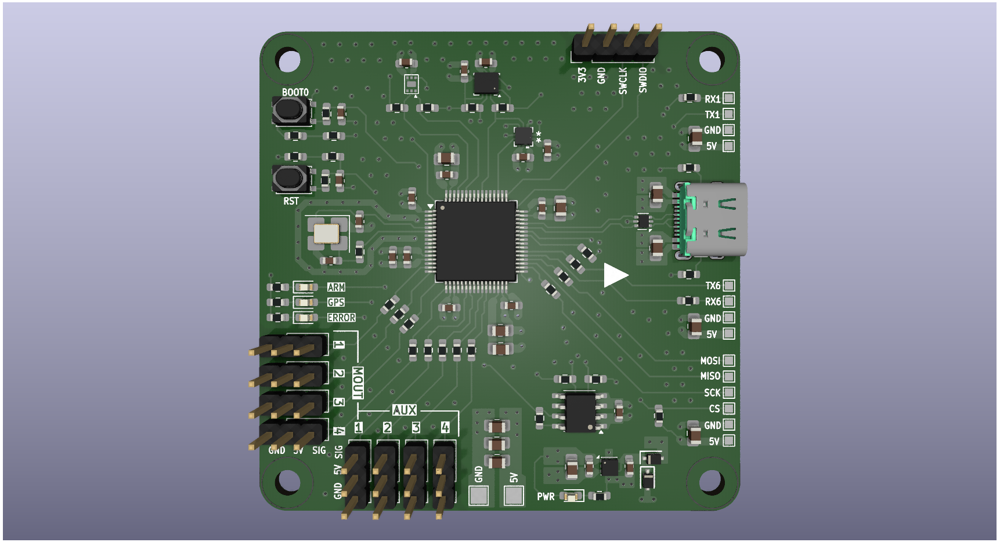
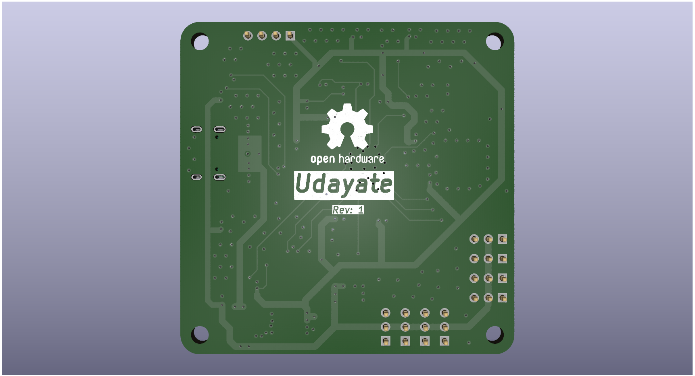

# Udayate
An open source flight controller based on STM32F411 microcontroller.

## NOTE:
This flight controller has flaws and I no longer recommended to build this.
Instead, use [this](https://github.com/Ozonised/FeroFlyF405) newer design which already run INAV 9.
